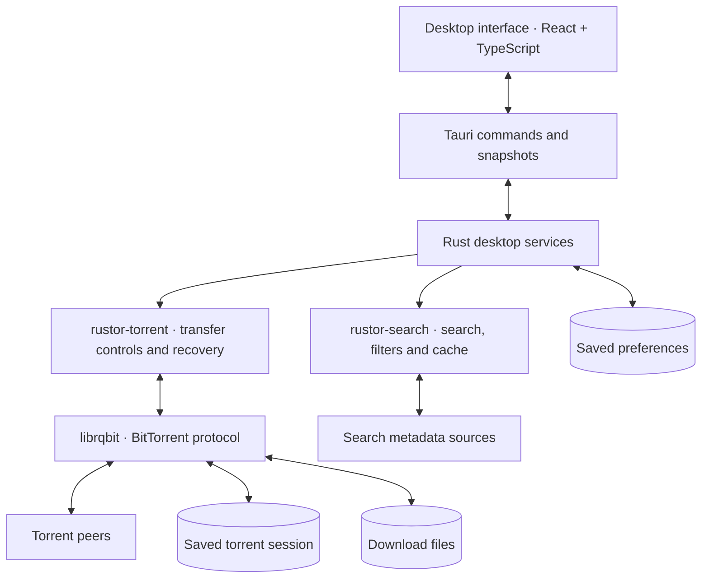
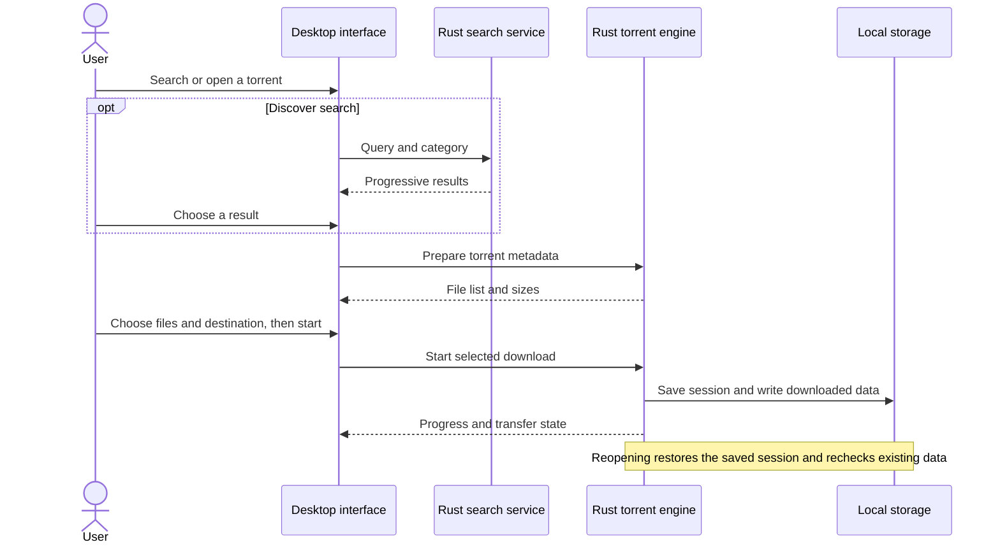

<p>
  
</p>

# RusTor

**Find torrents. Download the files you need.**

RusTor is a desktop BitTorrent client with built-in search, selective downloads, and a Rust engine. Search in Discover or add your own torrent, preview its files, and manage downloading and seeding from one window.

[Get RusTor](#get-rustor) · [Features](#features) · [Architecture](#architecture) · [Support](#support)

## Features

- **Search from the app.** Browse Movies, TV, Games, and Anime. Sort results by relevance, seeders, size, or date, and check swarm counts before adding a torrent.
- **Download only what you need.** Open a magnet link or `.torrent` file, preview its contents, choose files, and set a destination before starting.
- **Manage several transfers at once.** Follow progress, speeds, and peer activity. Pause, resume, or retry a failed transfer from the Downloads screen.
- **Stop without deleting your files.** Remove a torrent to stop downloading or seeding while keeping complete and partial files on disk.
- **Pick up where you left off.** Saved torrents, destinations, and file selections return when you reopen RusTor. Existing data is checked before transfers resume.
- **Set your own limits.** Choose a default download folder and control download and upload speeds across your session.
- **Choose your theme.** Navy and peach in dark mode, with a warm light mode to match. Your appearance preference is saved, and animations respect reduced-motion settings.

## Get RusTor

[Download a preview build](https://github.com/adityapandeydev/RusTor/actions?query=workflow%3A%22Desktop+packages%22)

Open a successful **Desktop packages** run and download the artifact for your system. Extract the artifact archive to find the installer, license files, and checksums. GitHub requires you to sign in to download workflow artifacts, which are retained for 14 days.

| System | Package |
| --- | --- |
| Windows x64 | `.exe` installer or standalone `.zip` |
| Linux x64 | `.AppImage` or `.deb` |
| macOS Apple Silicon | `.dmg` |
| macOS Intel | `.dmg` |

You don't need Rust, Bun, or Node.js to use the app. On Windows, the installer can download WebView2 if it is missing; the standalone ZIP requires WebView2 to be installed already. The ZIP uses the same saved profile as an installed copy.

**These are unsigned preview builds.** Windows and macOS may display security warnings. macOS notarization is not configured, and Linux/macOS desktop interaction and installation are not yet fully validated.

### Your first download

1. Search in **Discover**, or use **Add torrent** to paste a magnet link, enter a v1 infohash, or open a `.torrent` file.
2. Review the file list, choose what to download, and select a destination.
3. Start the transfer and follow it in **Downloads**. Use pause, resume, retry, or the × control to stop it and remove it from the session.

Downloads go to `Downloads/RusTor` by default. Closing RusTor stops downloading and seeding; there is no background tray service. Reopening the app restores the saved session and rechecks downloaded data, which can take time for large files.

Search results depend on the availability of external sources; counts can be unavailable or up to five minutes old. RusTor currently supports v1 torrent identities and rejects v2-only torrents. It does not mask your IP address or include a VPN. Share only content you have permission to distribute.

## Architecture

The interface uses **React, TypeScript, Vite, and Tailwind CSS v4**, with **Bun** for development tooling. **Tauri 2** connects it to the Rust backend. Search and torrent management run in separate Rust crates; the torrent engine uses librqbit for the BitTorrent protocol. The installed app does not run a Node.js or Bun server.



Search retrieves metadata. A download starts only after you choose a torrent and confirm its files. Session data and preferences stay in the operating system's application-data folder; payloads stay in your chosen download directory.

### From search to download



## Build from source

<details>
<summary>Development setup, checks, and packaging</summary>

Install Bun 1.3.5, Node.js 24, Rust 1.98.1, and the [Tauri platform prerequisites](https://v2.tauri.app/start/prerequisites/). Build packages on their target operating system.

```sh
git clone https://github.com/adityapandeydev/RusTor.git
cd RusTor
bun install --frozen-lockfile
bun run desktop:dev
```

Run the checks:

```sh
bun run check
bun run test
bun run test:packaging
cargo fmt --all -- --check
cargo test --workspace --locked
cargo clippy --workspace --all-targets --locked -- -D warnings
```

Build an executable with `bun run desktop:build`. To create native preview packages, install the release tools globally in your user profile:

```sh
cargo install cargo-audit --version 0.22.2 --locked
cargo install cargo-about --version 0.9.3 --features cli --locked
bun run desktop:package
```

Packaging audits dependencies and includes the README, project license, generated third-party notices, build provenance, and `SHA256SUMS`. Output is under the Cargo target directory's `packages/<native-target>/<version>-<run>/`, respecting `CARGO_TARGET_DIR`. The workflow uploads preview artifacts without publishing a release. Automatic updates are not included.

Linux distribution compatibility and bundled system-library notices need review before a public release.

The GTK dependency stack has two upstream RustSec informational warnings: [proc-macro-error maintenance](https://rustsec.org/advisories/RUSTSEC-2024-0370) and [glib VariantStrIter unsoundness](https://rustsec.org/advisories/RUSTSEC-2024-0429). Audits keep these visible; no advisory ignore list is configured.

</details>

## Support

If RusTor is useful to you, you can help by [reporting a bug or suggesting an improvement](https://github.com/adityapandeydev/RusTor/issues).

**Buy Me a Coffee — coming soon.**
<!-- Replace this placeholder with the Buy Me a Coffee link when it is ready. -->

## Credits and license

RusTor is independently maintained and draws on [Torlink](https://github.com/baairon/torlink), created by bairon.dev and its contributors. Its search adapters, result handling, magnet helpers, cache policy, and torrent-management behavior informed or were ported into RusTor's Rust implementation from [this upstream revision](https://github.com/baairon/torlink/tree/df059311d0898b7245dd842153c1ff7c892275ee). RusTor is not an official Torlink release and does not distribute its terminal interface. Torlink's MIT notice is retained below.

<details>
<summary>Torlink MIT License notice</summary>

```text
MIT License

Copyright (c) 2026 bairon.dev

Permission is hereby granted, free of charge, to any person obtaining a copy
of this software and associated documentation files (the "Software"), to deal
in the Software without restriction, including without limitation the rights
to use, copy, modify, merge, publish, distribute, sublicense, and/or sell
copies of the Software, and to permit persons to whom the Software is
furnished to do so, subject to the following conditions:

The above copyright notice and this permission notice shall be included in all
copies or substantial portions of the Software.

THE SOFTWARE IS PROVIDED "AS IS", WITHOUT WARRANTY OF ANY KIND, EXPRESS OR
IMPLIED, INCLUDING BUT NOT LIMITED TO THE WARRANTIES OF MERCHANTABILITY,
FITNESS FOR A PARTICULAR PURPOSE AND NONINFRINGEMENT. IN NO EVENT SHALL THE
AUTHORS OR COPYRIGHT HOLDERS BE LIABLE FOR ANY CLAIM, DAMAGES OR OTHER
LIABILITY, WHETHER IN AN ACTION OF CONTRACT, TORT OR OTHERWISE, ARISING FROM,
OUT OF OR IN CONNECTION WITH THE SOFTWARE OR THE USE OR OTHER DEALINGS IN THE
SOFTWARE.
```

</details>

The BitTorrent protocol implementation is provided by [librqbit / rqbit](https://github.com/ikatson/rqbit), by Igor Katson and contributors, under Apache-2.0. RusTor also uses their pinned [upstream µTP security fix](https://github.com/ikatson/librqbit-utp/commit/f119a999657d66fe2c2322613428241ce8a69f23) for RUSTSEC-2026-0293.

RusTor's original code is available under the [MIT License](LICENSE). Dependencies retain their own licenses; packaged builds include `THIRD_PARTY_NOTICES.txt`.
